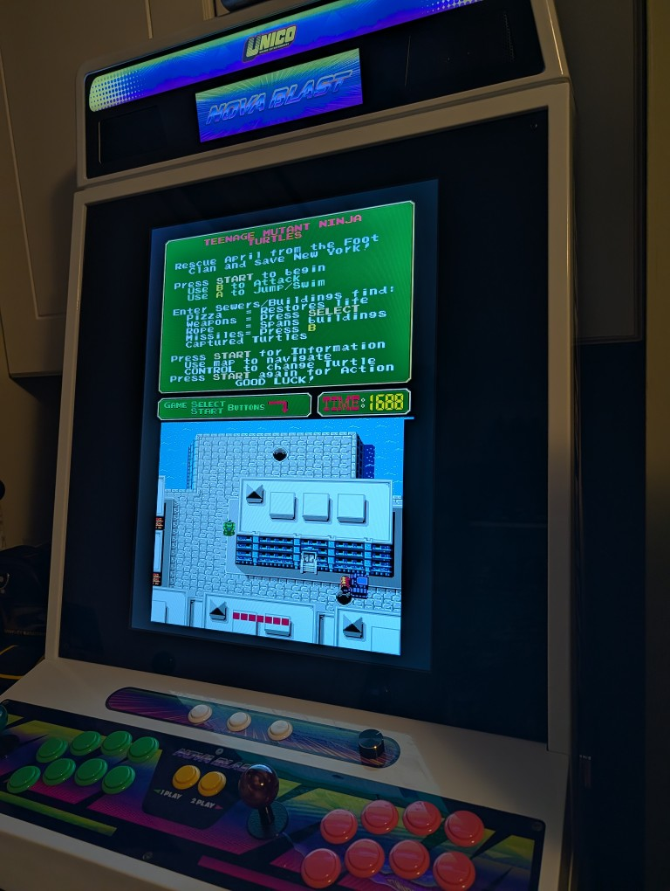
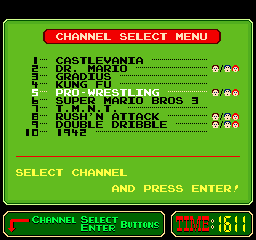
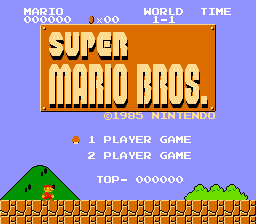
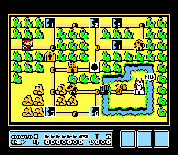
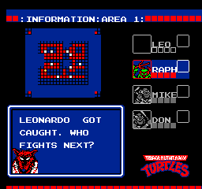
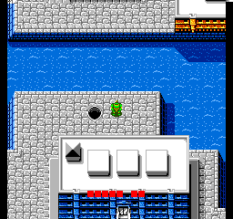
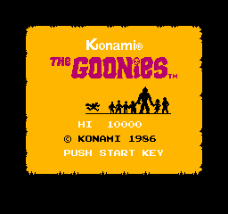
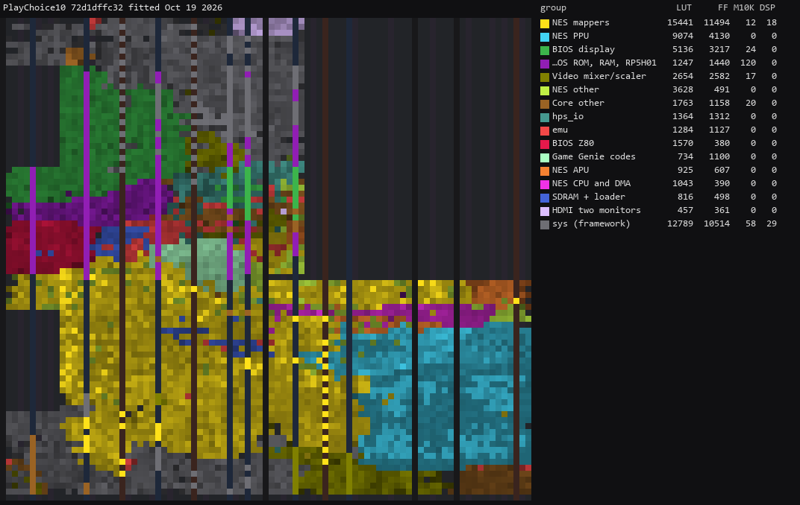

# PlayChoice-10 core for MiSTer

A MiSTer FPGA core for Nintendo's PlayChoice-10 arcade hardware (MAME's `playch10.cpp`), built
with Quartus Prime 17.0.2 Lite for the DE10-nano. This is an extension of 
[NES_MiSTer](https://github.com/MiSTer-devel/NES_MiSTer) to add the bios, dual monitor and channel selection.

## Contents

- [History](#history)
- [Screenshots](#screenshots)
- [Games](#games)
  - [Supported](#supported)
  - [Cabinets: several games in one .mra](#cabinets-several-games-in-one-mra)
- [Hardware](#hardware)
  - [Video timing](#video-timing)
  - [Two monitors](#two-monitors)
  - [Floorplan](#floorplan)
- [Installation](#installation)
- [Controls](#controls)
- [Status](#status)
  - [Features](#features)
  - [Todo](#todo)
  - [Resource usage](#resource-usage)
- [AI Attestation](#ai-attestation)
- [Verification](#verification)
- [Acknowledgements](#acknowledgements)
- [Layout](#layout)
- [License](#license)

## History

`Arcade-PlayChoice10_20261018.rbf`: **alpha release**
- Build your own gamelist of 10 games, or there's one MRA for each of the individual titles
- No lightgun support yet
- Alpha as not hugely tested. Based on the MiSTer-devel NES core though

## Screenshots

**On a cabinet**, both monitors stacked on an upright screen

The rest are native frames from a DE10-nano.

**The BIOS menu** of a ten-channel cabinet

**Super Mario Bros.**

**Super Mario Bros. 3**

**Teenage Mutant Ninja Turtles**

**The Goonies**

## Games

Each individual game has its own `.mra`, however you can build an MRA for any permutation you want. See below.

### Supported

| Name | Year | Manufacturer | Board | Mapper | Set | Notes |
|-|-|-|-|-|-|-|
| 1942 | 1987 | Capcom | Standard | NROM | `pc_1942` |  |
| Balloon Fight | 1984 | Nintendo | Standard | NROM | `pc_bfght` |  |
| Baseball | 1984 | Nintendo of America | Standard | NROM | `pc_bball` |  |
| Baseball Stars: Be a Champ! | 1989 | SNK (Nintendo of America license) | F | MMC1 | `pc_bstar` | MAME: imperfect graphics |
| Bases Loaded (Prototype) | 1990 | Jaleco (Nintendo of America license) | F | MMC1 | `pc_bload` |  |
| Captain Sky Hawk | 1989 | Rare (Nintendo of America license) | I | AxROM | `pc_cshwk` | MAME: imperfect graphics |
| Castlevania | 1987 | Konami (Nintendo of America license) | B | UNROM | `pc_cvnia` |  |
| Chip'n Dale: Rescue Rangers | 1990 | Capcom USA (Nintendo of America license) | F | MMC1 | `pc_rrngr` |  |
| Contra | 1988 | Konami (Nintendo of America license) | B | UNROM | `pc_cntra` |  |
| Double Dragon | 1988 | Technos Japan | F | MMC1 | `pc_ddrgn` |  |
| Double Dribble | 1987 | Konami (Nintendo of America license) | B | UNROM | `pc_dbldr` |  |
| Dr. Mario | 1990 | Nintendo | F | MMC1 | `pc_drmro` |  |
| Duck Hunt | 1984 | Nintendo | Standard | NROM | `pc_duckh` |  |
| Excitebike | 1984 | Nintendo | Standard | NROM | `pc_ebike` | MAME: imperfect graphics |
| Gauntlet | 1985 | Atari / Tengen (Nintendo of America license) | G | MMC3 | `pc_gntlt` | four-screen |
| Golf | 1984 | Nintendo | Standard | NROM | `pc_golf` |  |
| Gradius | 1986 | Konami | A | CNROM | `pc_grdus` |  |
| Gradius (PlayChoice-10, older) | 1986 | Konami | A | CNROM | `pc_grdue` | clone of `pc_grdus` |
| Hogan's Alley | 1984 | Nintendo | Standard | NROM | `pc_hgaly` |  |
| Kung Fu | 1985 | Irem (Nintendo license) | Standard | NROM | `pc_kngfu` |  |
| Mario Bros. | 1983 | Nintendo | Standard | NROM | `pc_mario` |  |
| Mario's Open Golf | 1991 | Nintendo | K | MMC1 | `pc_moglf` |  |
| Mega Man III | 1990 | Capcom USA (Nintendo of America license) | G | MMC3 | `pc_mman3` |  |
| Metroid | 1986 | Nintendo | D | MMC1 | `pc_mtoid` | on the board in a three-channel cabinet |
| Mike Tyson's Punch-Out!! | 1987 | Nintendo | E | MMC2 | `pc_miket` | MAME: imperfect graphics |
| Ninja Gaiden | 1989 | Tecmo (Nintendo of America license) | F | MMC1 | `pc_ngaid` |  |
| Ninja Gaiden Episode II: The Dark Sword of Chaos | 1990 | Tecmo (Nintendo of America license) | G | MMC3 | `pc_ngai2` | MAME: imperfect graphics |
| Ninja Gaiden Episode III: The Ancient Ship of Doom | 1991 | Tecmo (Nintendo of America license) | G | MMC3 | `pc_ngai3` |  |
| Nintendo World Cup | 1990 | Technos Japan (Nintendo license) | G | MMC3 | `pc_wcup` |  |
| PinBot | 1988 | Rare (Nintendo of America license) | H | TQROM | `pc_pinbt` | MAME: imperfect graphics |
| Power Blade | 1991 | Taito (Nintendo of America license) | G | MMC3 | `pc_pwbld` |  |
| Pro Wrestling | 1986 | Nintendo | B | UNROM | `pc_pwrst` |  |
| R.C. Pro-Am | 1987 | Rare | F | MMC1 | `pc_rcpam` |  |
| Rad Racer | 1987 | Square | D | MMC1 | `pc_radrc` | MAME: imperfect graphics |
| Rad Racer II | 1990 | Square (Nintendo of America license) | G | MMC3 | `pc_radr2` | MAME: imperfect graphics; four-screen |
| Rockin' Kats | 1991 | Atlus (Nintendo of America license) | G | MMC3 | `pc_rkats` |  |
| Rush'n Attack | 1987 | Konami (Nintendo of America license) | B | UNROM | `pc_rnatk` |  |
| Rygar | 1987 | Tecmo (Nintendo of America license) | B | UNROM | `pc_rygar` |  |
| Solar Jetman | 1990 | Rare | I | AxROM | `pc_sjetm` | MAME: imperfect graphics |
| Super C | 1990 | Konami (Nintendo of America license) | G | MMC3 | `pc_suprc` |  |
| Super Mario Bros. | 1985 | Nintendo | Standard | NROM | `pc_smb` | played on the board |
| Super Mario Bros. 2 | 1988 | Nintendo | G | MMC3 | `pc_smb2` |  |
| Super Mario Bros. 3 | 1988 | Nintendo | G | MMC3 | `pc_smb3` | played on the board |
| Tecmo Bowl | 1989 | Tecmo (Nintendo of America license) | F | MMC1 | `pc_tbowl` |  |
| Teenage Mutant Ninja Turtles | 1989 | Konami (Nintendo of America license) | F | MMC1 | `pc_tmnt` |  |
| Teenage Mutant Ninja Turtles II: The Arcade Game | 1990 | Konami (Nintendo of America license) | G | MMC3 | `pc_tmnt2` |  |
| Tennis | 1983 | Nintendo | Standard | NROM | `pc_tenis` |  |
| The Goonies | 1986 | Konami | C | 87 | `pc_goons` | title screen on the board |
| Tiny Toon Adventures (prototype) | 1991 | Konami (Nintendo of America license) | G | MMC3 | `pc_ttoon` |  |
| Track & Field | 1987 | Konami (Nintendo of America license) | A | CNROM | `pc_tkfld` |  |
| Trojan | 1986 | Capcom USA (Nintendo of America license) | B | UNROM | `pc_trjan` |  |
| Uncle Fester's Quest: The Addams Family | 1989 | Sunsoft (Nintendo of America license) | F | MMC1 | `pc_ftqst` |  |
| Virus (Dr. Mario prototype) | 1990 | Nintendo | F | MMC1 | `pc_virus` | clone of `pc_drmro` |
| Volley Ball | 1986 | Nintendo | Standard | NROM | `pc_vball` |  |
| Wild Gunman | 1984 | Nintendo | Standard | NROM | `pc_wgnmn` |  |
| Yo! Noid | 1990 | Capcom USA (Nintendo of America license) | F | MMC1 | `pc_ynoid` |  |

### Cabinets: several games in one .mra

The real cabinet holds up to ten carts, so unlike e.g. MAME, you cna build your own multi-slot configuration.

- **Pick them on a page:** open the
  [cabinet builder](https://mister-mame-coverage-docs.vercel.app/cabinet_builder.html), pick up
  to ten games, order them, and download the `.mra`. The same page is in
  [`tools/cabinet_builder.html`](tools/cabinet_builder.html) and runs from disk with no network.
- **Or from the command line:**
  `python scripts/build_mra.py --cabinet "My Cabinet" pc_smb3 pc_mman3 pc_ngaid`, channel 1
  first.

`releases/PlayChoice-10 (three channels).mra` is an example.

## Hardware

| Chip | Function | Status |
|-|-|-|
| Z80, 4 MHz | BIOS CPU | T80 (Daniel Wallner; via this author's Bally/Sente core); boot traced against MAME |
| BIOS display, 3 colour PROMs | top monitor | written here from `playch10.cpp`; pixel-checked against MAME |
| 2 x 74LS259, NMI, watchdog, INT DETECT | BIOS control of the NES | written here from `playch10.cpp` |
| RP5H01 x 10 | cart security PROM | written here from MAME's `rp5h01.cpp`, one per channel |
| RP2A03 (CPU, APU) | game CPU and sound | NES_MiSTer (T65, APU), vendored; resets and halt split for the BIOS |
| RP2C03B | game video | NES_MiSTer's PPU, vendored; MAME's RGB palette and emphasis |
| cart boards A-K | mappers | NES_MiSTer's mappers, chosen per set by a header the `.mra` carries |

### Video timing

Both monitors run on the PPU's raster: a 5.369318 MHz dot clock (21.477272 MHz / 4), 341 dots by
262 lines, 60.0988 Hz, 256 x 240 visible each. MAME declares its screens at 60.000 Hz; the core
keeps the PPU's own timing (`docs/MAME_KLUDGES.md`).

### Two monitors

The cabinet has two monitors: the BIOS display above, the game below. The board draws both at
once.

- **HDMI** (`Screen (HDMI)` in the OSD): **Stacked**, the default, one above the other as in the
  cabinet; *Side by side*; *Rotated CW* and *Rotated CCW*, the stack turned for a screen on its
  side; or *As CRT*, one picture. Both monitors are shown whole, 240 lines each.
- **CRT** (`Screen (CRT)`): one monitor at a time: *Auto* (the BIOS display while the BIOS hides
  the game, otherwise the game), *Game* or *Menu*.
- **Single-monitor BIOS** (`BIOS (reset)`): Nintendo's one-screen BIOS, swapping the game and the
  menu on one monitor.

### Floorplan

Where the logic sits on the Cyclone V, read from the compiled design with
`scripts/floorplan.py` (blocks defined in `scripts/floorplan.json`). One cell per LAB, M10K or DSP
site, coloured by the block owning most of it, brighter when fuller. The thin columns are M10K and
DSP; the empty area at the top right is the HPS; grey is the MiSTer framework. LUT counts are
combinational cells, two per ALM.

`22e84c0`, fitted Oct 18 2026; per-block counts in `docs/floorplan/PlayChoice10_groups.md`.

## Installation

* Take the latest `*.rbf` from `releases/` and put it in `_Arcade/cores`, renamed to drop the
  `Arcade-` prefix (`Arcade-PlayChoice10_20261018.rbf` becomes `PlayChoice10_20261018.rbf`).
  MiSTer launches the highest-sorting match for `<rbf>PlayChoice10</rbf>`, and a
  `PlayChoice10_*.rbf` sorts above every `Arcade-PlayChoice10_*.rbf`.
* Take the `*.mra` files and the `_alternatives` folder from `releases/` and put them in
  `_Arcade/_PlayChoice10` (or another subdirectory of `_Arcade` starting with an underscore).
* Put the MAME 0.289 ROM sets in `games/mame`: each game's zip and the BIOS, `playch10.zip`.

Every `.mra` names the set `playch10`, so the OSD settings and DIP switches are one file for the
core, whichever game or cabinet runs.

## Controls

| Button | Keyboard (MAME's keys) | Does |
|-|-|-|
| A, B | LAlt, LCtrl | the game's buttons |
| Game Select | 2 | the loaded cart's Select |
| Start | 1 | the loaded cart's Start |
| Coin 1 / 2 | 5 / 6 | adds time |
| Enter | - | picks the channel in the menu |
| Channel Select | 0 | moves through the channels |
| Service Coin | 9 | the BIOS's service button to add time |
| Reset | = | the reset button to get back to the game meu |

Directions are the arrows (player 2: R F D G).

## Status

Known issues:

- **Light-gun games** (Duck Hunt, Hogan's Alley, Wild Gunman) are not wired to a gun yet.
- **All sets have not been tested** (see [Supported](#supported)); boards A and C use
  NES mappers with wider address decodes than MAME's (`docs/HACKS.md`).
- **NES-only OSD entries remain** (peripherals, cheats, savestates): they come with NES_MiSTer and
  are not yet hidden or adapted.

`docs/MAME_KLUDGES.md` lists what is taken from MAME as behaviour and what is known not to be
right. `docs/HACKS.md` lists this core's own approximations. `docs/ROADMAP.md` is the plan and its
progress; `docs/LESSONS_LEARNED.md` is what it cost.

### Features

* DIP switches from the `.mra` (`DIP;` in the OSD): done. The two 6-bit switches are split in two,
  as MiSTer allows at most 32 settings a switch
* Inputs: done, two players, the BIOS buttons, and MAME's keys
* CRT Adjust (H-Position, V-Shift, H-Size, V-Size): not yet
* HDMI scaling (integer scale, crop, crop offset): NES_MiSTer's options, not checked here
* HDMI rotation (orientation): the stacked monitors turned CW or CCW; one picture turned, not yet
* Flip screen, HDMI and analog, from the OSD or the DIP (fake DIP where the game has none): not yet
* HDMI-only options hidden under direct video: not yet
* Peripheral menus shown only for games that use them: not yet
* Rotary joysticks (Ikari Warriors controls, GRS keystroke mode), where used: n/a
* Light guns: mouse, analog stick and synthetic crosshair, where used: not yet
* Audio mix (Mono, None, 25%, 50%): n/a, the board is mono
* Hiscore saving (`hiscore.v`, with autosave): not yet
* NVRAM / EEPROM saved to the `.nvm` file: not yet checked (Punch-Out!!'s battery RAM)
* Fast ROM loading via DDR: n/a, a game is at most 512 KB
* Pause (with CPU suspended): not yet
* Sound: playing, not yet compared with MAME
* Savestates (optional): not yet (NES_MiSTer's cover the NES side only)
* Cheats (optional): not yet

### Todo

- [ ] Light guns for Duck Hunt, Hogan's Alley and Wild Gunman
- [ ] Pause, flip screen, CRT Adjust, hiscore
- [ ] Hide or adapt NES_MiSTer's NES-only OSD entries
- [ ] Per-game button names
- [ ] Sound against MAME, by ear
- [ ] First release

### Resource usage

`22e84c0`, release revision, on the DE10-nano's Cyclone V 5CSEBA6, speed grade 7, every clock
meeting timing (worst `clk_sys` setup slack +1.609 ns):

| resource | used | available |
| --- | --- | --- |
| Logic (ALMs) | 34,905 | 41,910 |
| Block memory bits | 1,776,356 | 5,662,720 |
| RAM blocks | 248 | 553 |
| DSP blocks | 47 | 112 |
| PLLs | 3 | 6 |

Logic is the one to watch: at 83-85% the framework's HDMI scaler failed timing in three builds,
which is why the scaler's adaptive filter is off (`MISTER_DISABLE_ADAPTIVE`) and NES_MiSTer's
composite-video path is left out.

## AI Attestation

This core is being developed with heavy use of a frontier coding assistant, directed and tested on
the board by the author.

## Verification

Not PCB-validated. MAME is the accuracy reference, with its own acknowledged uncertainties noted
where they matter.

* The BIOS Z80 from reset, pc_smb: 8,393,343 bus accesses identical to MAME's (600 frames, through
  the channel menu), and all 2,085,200 instructions of MAME's debugger trace over the first 4 s
  starting on the same cycle (`sim/bios_boot_tb`).
* The BIOS display: a model of `playch10.cpp`'s drawing equals MAME's top screen on 7 frames
  (0 pixels differ), and the RTL equals the model on the same 7 (`sim/bios_video_tb`). On the
  board, the menu equals MAME's frame 600 in rows 0-207 (rows 208-223 animate).
* The game picture and palette: pc_smb's title on the board differs from MAME's in 24 of 57,344
  pixels, all in the colour-cycling coin; pc_smb3's title rows 0-96 are identical to MAME's.
* The HDMI layouts: every one of 114,688 pixels lands right in each of the four layouts
  (`sim/pc10_fb_tb`).
* `.mra` files: generated from MAME's `-listxml` and the driver; the BIOS image and pc_smb's cart
  image are byte-identical to the ROM files; all 57 pass `scripts/validate_mra.py`.

## Acknowledgements

- **Sorgelig** and the **MiSTer-devel team** for the
  [Template_MiSTer](https://github.com/MiSTer-devel/Template_MiSTer) framework, and for
  `screen_rotate`, which the HDMI layouts follow.
- **Ludvig Strigeus**, **Sorgelig**, **Kitrinx** and the NES_MiSTer contributors for
  [NES_MiSTer](https://github.com/MiSTer-devel/NES_MiSTer): the CPU, APU, PPU, mappers, loader and
  SDRAM controller this core runs the games on.
- **Daniel Wallner** and the T80 maintainers for [T80](https://github.com/MiSTer-devel/T80), the
  BIOS's Z80.
- The **MAMEdev team**, **Ernesto Corvi** and **Brad Oliver** for `playch10.cpp`, and
  **Nicola Salmoria** for `rp5h01.cpp`: the specification this core follows.

## Layout

Standard [Template_MiSTer](https://github.com/MiSTer-devel/Template_MiSTer) structure:

| path | contents |
| - | - |
| `sys` | MiSTer framework, vendored from the template, never edited |
| `rtl` | core source; vendored modules (`rtl/nes`, `rtl/cpu/t80`) carry a `PROVENANCE.md` |
| `releases` | `.mra` files; clones in `_alternatives` |
| `tools` | `cabinet_builder.html`, the page that makes cabinet `.mra` files |
| `docs` | roadmap, workflow, release process, kludges, hacks, lessons, screenshots |
| `sim` | ModelSim testbenches |
| `scripts` | build, deploy, `.mra` generation, capture and verification tooling |
| `debug` | reference captures from MAME used as ground truth (gitignored) |
| `roms` | your own MAME sets (gitignored, never committed) |

## License

GPL-3.0-or-later (see `LICENSE`), as NES_MiSTer's GPL-3.0 requires. Imported components keep their
own licences; each vendored directory's `PROVENANCE.md` has the detail and every local change.

Game ROMs contain copyrighted material and are not included. Obtaining them is your
responsibility.
